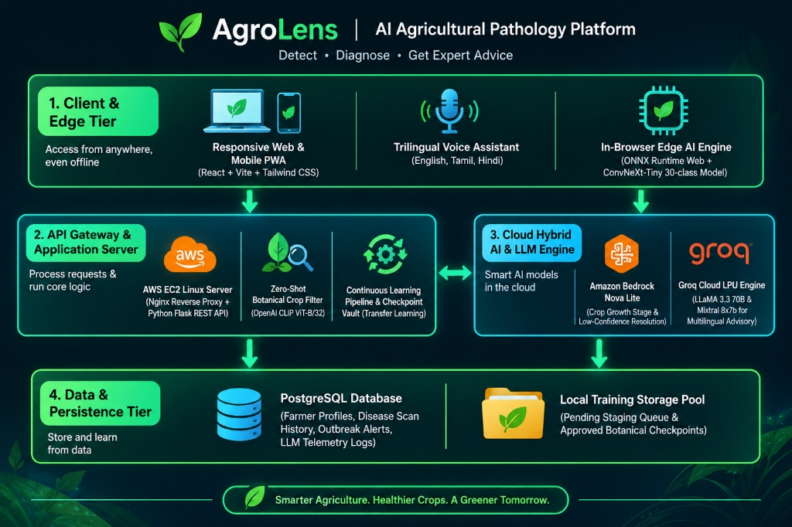
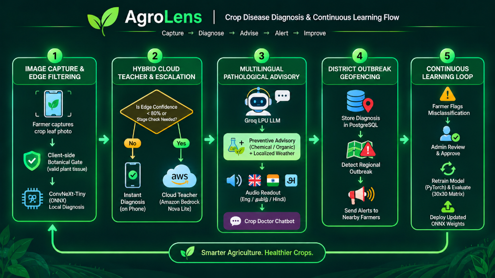
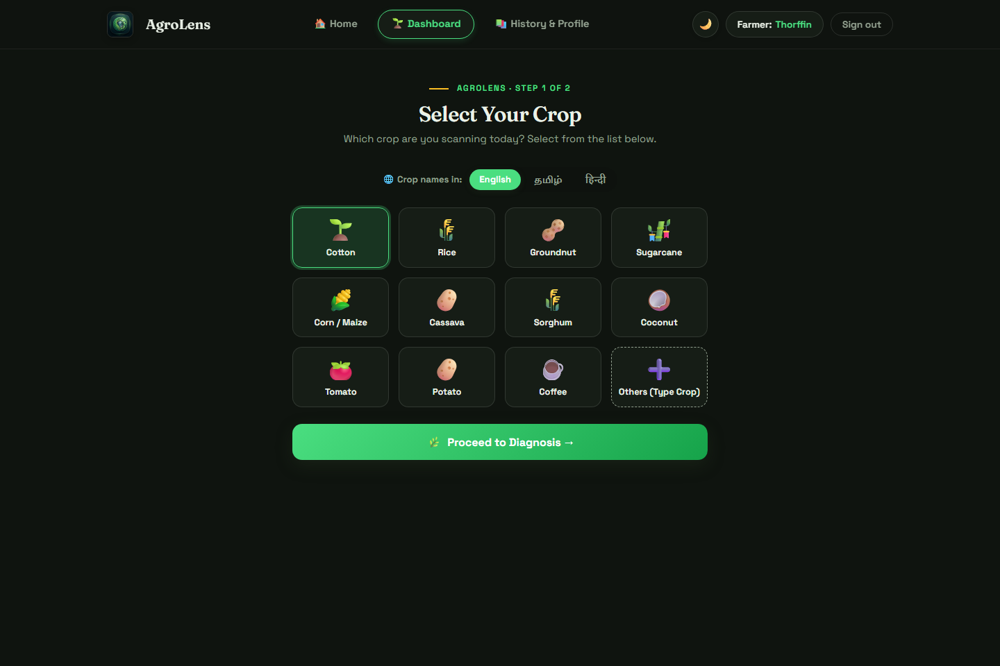
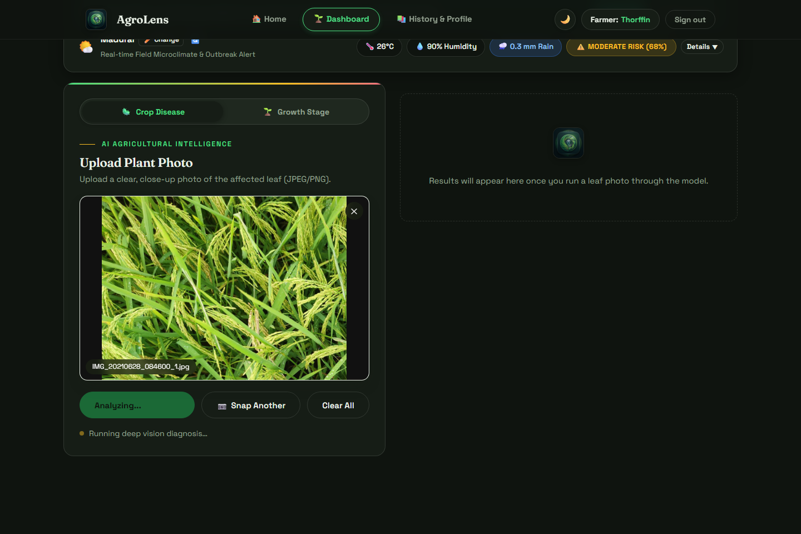
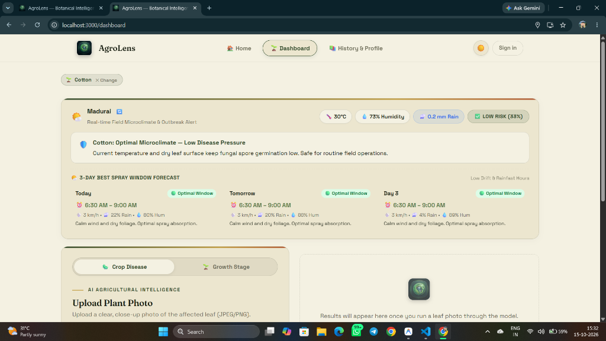
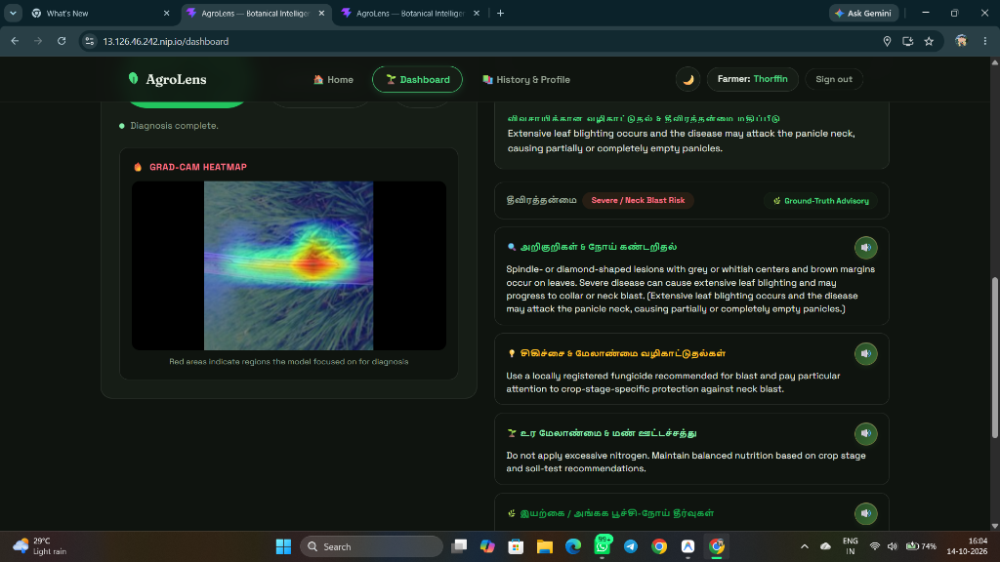
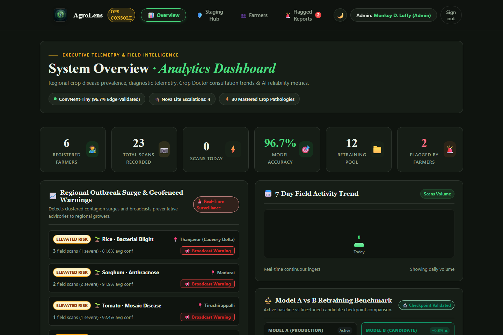

# 🌱 AgroLens — AI Agricultural Pathology & Growth Stage Intelligence Platform

> **Edge-to-Cloud Hybrid Crop Pathology, Multilingual Phenology, and Continuous Learning Platform for Resilient Agriculture.**

[](https://react.dev/)
[](https://flask.palletsprojects.com/)
[](https://pytorch.org/)
[](https://onnxruntime.ai/)
[](https://aws.amazon.com/bedrock/)
[](https://groq.com/)
[](https://www.postgresql.org/)

---

## 📌 Executive Overview

**AgroLens** is a next-generation agricultural intelligence platform engineered to bridge the gap between rural low-bandwidth farm environments and advanced cloud artificial intelligence. 

By leveraging an **Edge-to-Cloud Hybrid architecture**, AgroLens enables farmers to perform instant, offline plant disease diagnostics directly inside mobile browsers via client-side neural inference (**ConvNeXt-Tiny ONNX**), backed by a cloud teacher model (**Amazon Bedrock Nova Lite**) for complex growth stage phenology, real-time localized weather risk forecasting, trilingual voice synthesis (**English, Tamil, Hindi**), and automated continuous learning pipelines.

---

## 🏛️ System Architecture

AgroLens is organized into four interconnected functional tiers designed for offline resilience, high throughput, and data security:



1. **Client & Edge Tier (PWA)**:
   - Built with **React 18, Vite, and Tailwind CSS**.
   - Offline-first neural inference powered by **ONNX Runtime Web**, running a quantized **ConvNeXt-Tiny 30-class model** locally in the browser with zero cloud latency.
   - Trilingual voice synthesis & audio readout across **English, Tamil, and Hindi**.
2. **API Gateway & Core Server**:
   - Hosted on **AWS EC2 Linux (Ubuntu)** reverse-proxied via **Nginx** and managed by **Systemd**.
   - **Flask REST API** handling botanical gates, continuous retraining queues, weather synthesis, and district geofencing.
   - **OpenAI CLIP (ViT-B/32)** zero-shot botanical validator filtering out non-foliar uploads.
3. **Cloud Hybrid AI & LLM Engine**:
   - **Amazon Bedrock (Nova Lite)**: Cloud teacher model resolving ambiguous edge scans and classifying phenological growth stages.
   - **Groq Cloud LPU Engine (LLaMA 3.3 70B & Mixtral 8x7B)**: Sub-second generative agronomic advisory and conversational interactive Crop Doctor.
4. **Data & Persistence Tier**:
   - **PostgreSQL 16**: Relational storage for grower profiles, geo-tagged scan histories, outbreak warning subscriptions, and LLM telemetry accounting.
   - **Continuous Learning Storage Pool**: Active training vault, approved botanical checkpoints, and sample staging queues.

---

## 🔄 End-to-End User & Data Flow

From foliar image capture in the field to automated district outbreak containment and model retraining:



1. **Capture & Edge Validation**: The farmer captures a leaf photo. The client-side gate confirms healthy leaf tissue before inference.
2. **Hybrid Cloud Escalation**: If edge confidence is $\ge 80\%$, the client displays an instant diagnosis. If ambiguous ($< 80\%$) or when a growth stage check is requested, it seamlessly escalates to Amazon Bedrock Nova Lite.
3. **Multilingual Advisory**: The verified condition and field weather microclimate trigger the Groq LPU engine to generate organic/chemical prescriptions and localized audio voice readouts.
4. **District Geofencing**: Regional clusters in PostgreSQL trigger automated geofenced warning broadcasts to all registered growers in that district.
5. **Continuous Learning Loop**: Farmers can flag misdiagnoses, sending images to the Admin Review Queue. Approved samples feed into background PyTorch transfer learning with 30×30 confusion matrix validation.

---

## 📸 Key Application Features

### 1. Trilingual Crop Selection & Microclimate Weather Forecast
Farmers select from supported major staple crops with native language translations (**English, தமிழ், हिन्दी**) alongside real-time field microclimate metrics, disease risk level, and a **3-Day Best Spray Window Forecast**.



---

### 2. Neural Disease Diagnosis & Grad-CAM Explainability Heatmap
Instant classification featuring confidence gauges, high-resolution **Grad-CAM visual attention heatmaps** highlighting exact foliar necrosis spots, severity guidance, and chemical/organic treatment protocols.



---

### 3. Interactive AI Crop Doctor & Precision Spray Calculator
An interactive multilingual conversational agronomist paired with an integrated **Precision Spray Dosage Calculator** that calibrates active ingredients, water volume, and tank ratios across backpack sprayers and tractor tanks based on exact farm acreage.





---

### 4. Admin Governance, Dynamic Confusion Radar & Outbreak Geofencing
A central monitoring dashboard displaying live outbreak geographical clusters, registered grower directories, LLM cost & token accounting, and a **dynamic 30×30 confusion matrix radar** featuring dynamic biological misclassification explanations powered by LLM pathology analysis.



---

## 🗂️ Project Structure

```
agrolens/
├── backend/
│   ├── app.py                      # Flask REST API, authentication & routing
│   ├── retrain_engine.py           # PyTorch transfer learning & 30x30 confusion matrix
│   ├── retrain_stage_engine.py     # Crop growth stage retraining & ONNX exporter
│   ├── groq_advisory.py            # Groq LPU multilingual pathology engine
│   ├── bedrock_service.py          # Amazon Bedrock Nova Lite teacher client
│   ├── schema.sql                  # PostgreSQL schema & idempotent migrations
│   ├── requirements.txt            # Python dependencies
│   ├── .env.example                # Configuration template
│   └── training_pool/              # Staged, approved, and rejected datasets
├── frontend/
│   ├── src/
│   │   ├── pages/
│   │   │   ├── DashboardPage.jsx   # Farmer diagnostic suite & camera workflow
│   │   │   ├── AdminPage.jsx       # Admin command center & confusion radar
│   │   │   ├── HistoryPage.jsx     # Longitudinal scan history & profiles
│   │   │   ├── LoginPage.jsx       # Secure auth & role routing
│   │   │   └── SignupPage.jsx      # Grower registration & district assignment
│   │   ├── components/             # Reusable UI components & weather cards
│   │   └── App.jsx                 # Client router & PWA providers
│   ├── public/
│   │   ├── leaflet_model.onnx      # Quantized ConvNeXt-Tiny ONNX model
│   │   └── class_names.json        # 30-class canonical disease dictionary
│   ├── package.json
│   └── vite.config.js
├── docs/
│   └── images/                     # System architecture, flow diagrams, and screenshots
├── .github/
│   └── workflows/
│       └── deploy.yml              # Automated GitHub Actions deployment to AWS EC2
└── deploy_ec2.sh                   # EC2 bootstrap & provisioning script
```

---

## 🚀 Quick Start Guide

### Prerequisites
- **Node.js** $\ge 18$
- **Python** $\ge 3.10$
- **PostgreSQL** $\ge 14$
- **Git** & **Git LFS**

---

### 1. Database Setup
Create the PostgreSQL database and user:
```sql
CREATE USER postgres WITH PASSWORD '6379';
CREATE DATABASE agrolens OWNER postgres;
GRANT ALL PRIVILEGES ON DATABASE agrolens TO postgres;
```
*(Database tables and schemas are created automatically on first backend launch).*

---

### 2. Backend Installation & Configuration
```bash
cd backend
python -m venv venv

# Linux / macOS
source venv/bin/activate
# Windows
.\venv\Scripts\activate

pip install -r requirements.txt
```

Create `backend/.env` with your API credentials:
```env
DB_HOST=localhost
DB_PORT=5432
DB_NAME=agrolens
DB_USER=postgres
DB_PASSWORD=6379

PORT=8000
SECRET_KEY=your_secure_hex_key_here
SESSION_COOKIE_SECURE=0

# AI Provider Credentials
GROQ_API_KEY=your_groq_api_key_here
BEDROCK_API_KEY=your_bedrock_bearer_key_here
BEDROCK_REGION=ap-south-1
BEDROCK_MODEL_ID=apac.amazon.nova-lite-v1:0
```

Start the Flask backend:
```bash
python app.py
```

---

### 3. Frontend Installation & Build
```bash
cd ../frontend
npm install
npm run build
```

The compiled production bundle in `frontend/dist` is served directly by Flask at `http://localhost:8000`.

---

## 🛡️ Security & Enterprise Governance

- **Password Hashing**: Industry-standard **scrypt** salt hashing via `werkzeug.security`.
- **Brute-Force Rate Limiting**: Exponential throttling against automated credential-stuffing attacks tracked persistently in PostgreSQL.
- **SQL Injection Prevention**: All queries use parameterized psycopg executions.
- **Protected ONNX Weights**: The 111.5 MB model weights are served exclusively to authenticated user sessions via guarded endpoints (`/leaflet_model.onnx`).
- **Role-Based Access Control (RBAC)**: Strict segregation between farmer scanning capabilities and administrative retraining/broadcast permissions.

---

## 🌐 Cloud Deployment (AWS EC2)

The repository features an automated CI/CD pipeline ([`.github/workflows/deploy.yml`](.github/workflows/deploy.yml)):
1. Every push to `main` triggers GitHub Actions.
2. Connects to the AWS EC2 instance over secure SSH.
3. Automatically pulls changes, compiles the Vite frontend, updates Python packages, and restarts the `agrolens.service` Systemd daemon behind Nginx.

---

## 📄 License
This project is licensed under the MIT License — see the [LICENSE](LICENSE) file for details.
